<p align="center">
  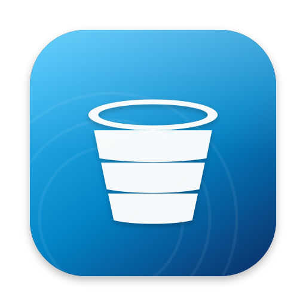
</p>

<h1 align="center">CcinnBucket</h1>

<p align="center">
  <b>A fast, native macOS client for object storage: Amazon S3, S3-compatible services and Alibaba Cloud OSS.</b><br>
  Browse buckets with millions of objects, move multi-GB files with resumable multipart transfers, and let AI tools explore your storage safely over MCP.
</p>

<p align="center">
  <a href="https://github.com/whiteCcinn/ccinnbucket/actions/workflows/ci.yml"></a>
  <a href="https://github.com/whiteCcinn/ccinnbucket/releases/latest"></a>
  
  
  
  
  <a href="LICENSE"></a>
</p>

<p align="center">
  English · <a href="README.zh-CN.md">简体中文</a>
</p>

<p align="center">
  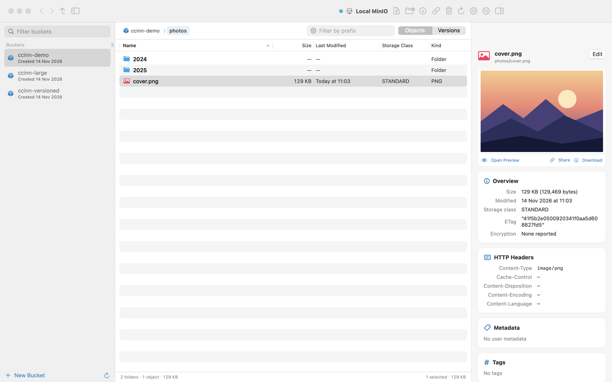
</p>

## Why CcinnBucket?

Object storage tools tend to be web consoles, command-line tools or cross-platform apps that treat Alibaba Cloud OSS as an afterthought. CcinnBucket is a native SwiftUI/AppKit app with its **own signing and storage stack** — AWS Signature V4, OSS Signature V4 (`OSS4-HMAC-SHA256`) and the legacy OSS V1 signature — written from scratch and verified byte for byte against the official SDKs. One interface works for Amazon S3, MinIO, Cloudflare R2, Ceph RGW, Wasabi, Tencent COS (S3 API) and Alibaba Cloud OSS. No Electron, no bundled runtimes, no telemetry, no third-party dependencies.

## Features

- **Every common provider** — Amazon S3 (virtual-hosted or path-style, automatic bucket-region discovery, STS session tokens), S3-compatible services with custom endpoints, and the native Alibaba Cloud OSS API (public, internal and accelerate endpoints, custom domains, OSS V4 or V1 signatures).
- **Huge buckets stay smooth** — prefix/folder navigation with breadcrumbs and back/forward, ListObjectsV2 paging with continuation tokens (automatic V1 fallback for older servers), a virtualised table that scrolls through 50,000+ objects, server-side prefix filter, sorting and multi-select.
- **Inspector and previews** — size, ETag, dates, storage class, content type, cache headers, user metadata, tags, version and encryption. Text (first 1 MiB via ranged GET), pretty-printed JSON, images, PDF and anything QuickLook understands.
- **Edit in place** — change content type, cache headers, user metadata, storage class and tags; header changes use a server-side self-copy (multipart copy for big objects) that keeps everything you did not change.
- **Transfers built for multi-GB files** — drag and drop files and folders, memory-bounded parallel multipart uploads with configurable part size, pause / resume / cancel (cancel aborts the multipart upload), resumable parallel ranged downloads into a partial file that is renamed only when complete, and a transfer queue with per-job and aggregate throughput.
- **Everyday operations** — create folders, rename, copy and move (server-side; multipart copy above 5 GiB on S3 and 1 GiB on OSS), batch delete with a confirmation that states the object count, presigned links with an expiry picker, versions and delete markers with restore, and incomplete multipart uploads you can review and abort.
- **Bucket settings** — versioning (enable/suspend), lifecycle, CORS, bucket policy, ACL and default encryption, shown as readable summaries plus the raw document.
- **Safe by design** — secret keys and session tokens live only in the macOS Keychain; per-account **read-only mode** refuses every change below the user interface; destructive actions always ask first; credentials from `~/.aws`, `~/.alibabacloud`, `~/.ossutilconfig` and `~/.aliyun/config.json` can be imported read-only.
- **AI access over MCP** *(opt-in)* — a built-in Model Context Protocol server lets Claude Code, Codex, Claude Desktop and other MCP clients list buckets and read objects through the accounts you enable. See [MCP server](#mcp-server--ai-access).

## Supported services

| Service | API | Signature | Tested |
|---|---|---|---|
| Amazon S3 | S3 REST | AWS SigV4 (header and presigned) | ✅ AWS-documented SigV4 examples and botocore-generated vectors |
| MinIO | S3 REST | AWS SigV4 | ✅ Live integration suite (MinIO RELEASE.2025-07-23) |
| Cloudflare R2, Ceph RGW, Wasabi, Tencent COS (S3 API), other S3-compatible | S3 REST | AWS SigV4 | Presets; same code path as MinIO |
| Alibaba Cloud OSS | OSS REST | `OSS4-HMAC-SHA256` (V4), HMAC-SHA1 (V1) | ✅ Vectors from `alibabacloud-oss-v2` (cross-checked with `oss2`) and `oss2`; request-construction tests. Not exercised against a live OSS endpoint in CI. |

CcinnBucket runs on **macOS 14 Sonoma or later** (Apple silicon and Intel).

## Screenshots

| 50,000 objects, fully loaded | Multipart upload in the transfer queue |
|---|---|
| 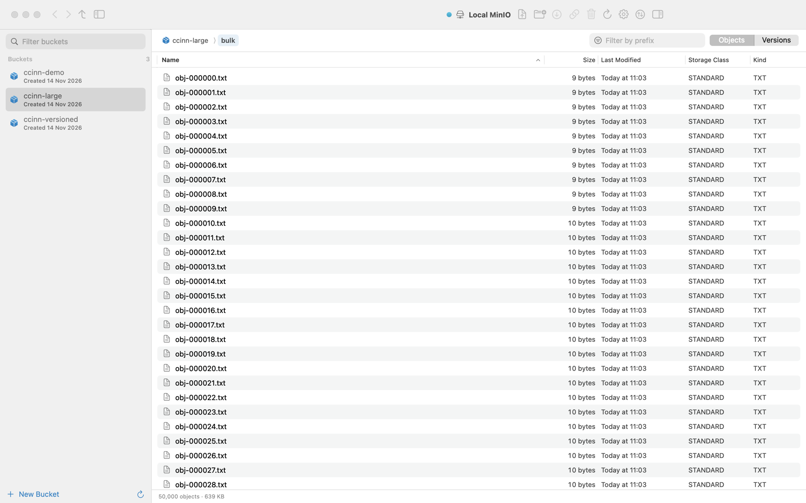 | 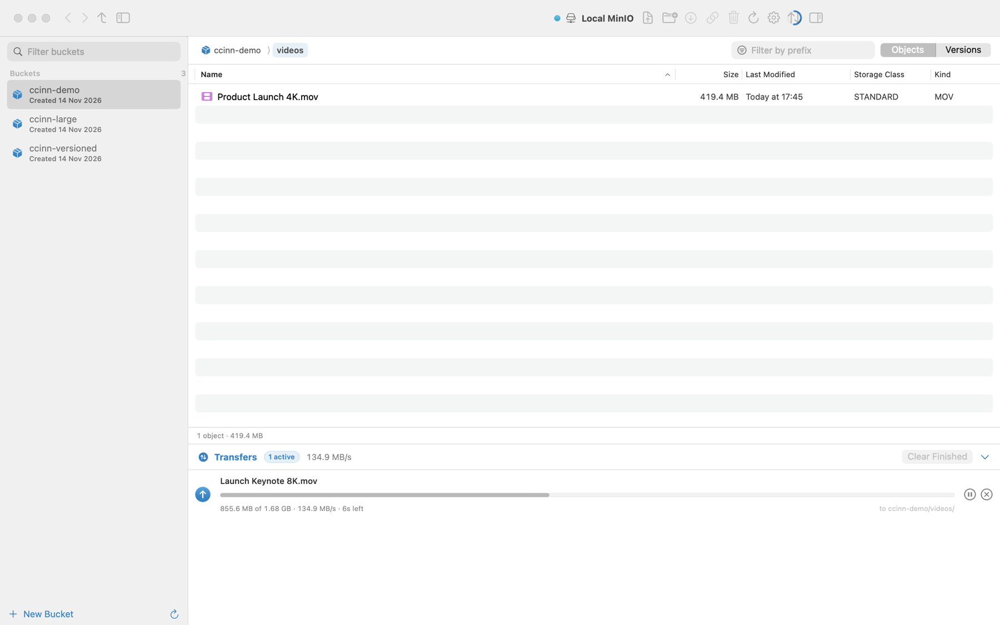 |
| **Accounts and providers** | **Versions and delete markers** |
| 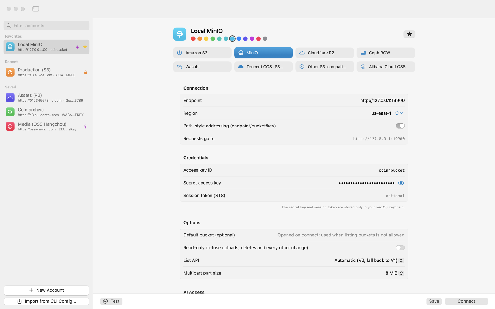 | 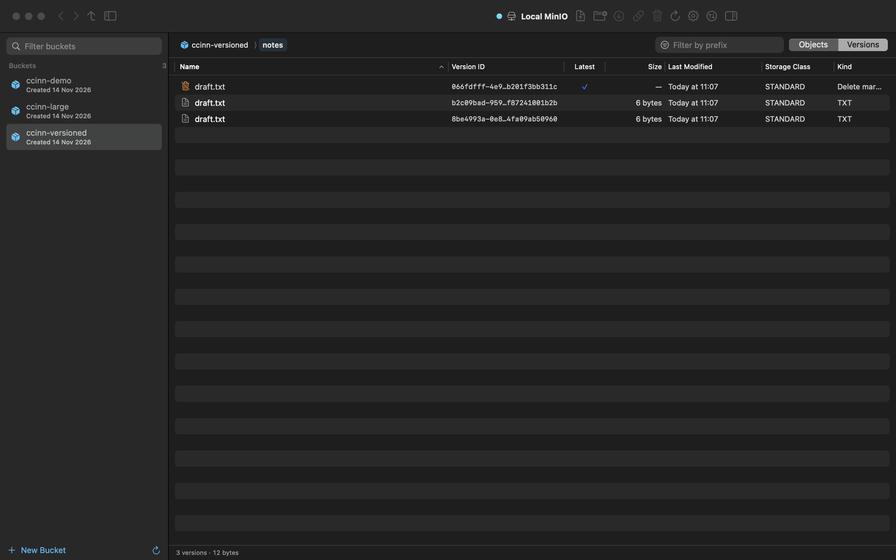 |
| **Ranged text preview (first 1 MiB of a 3 MB log)** | **Inspector in dark mode** |
| 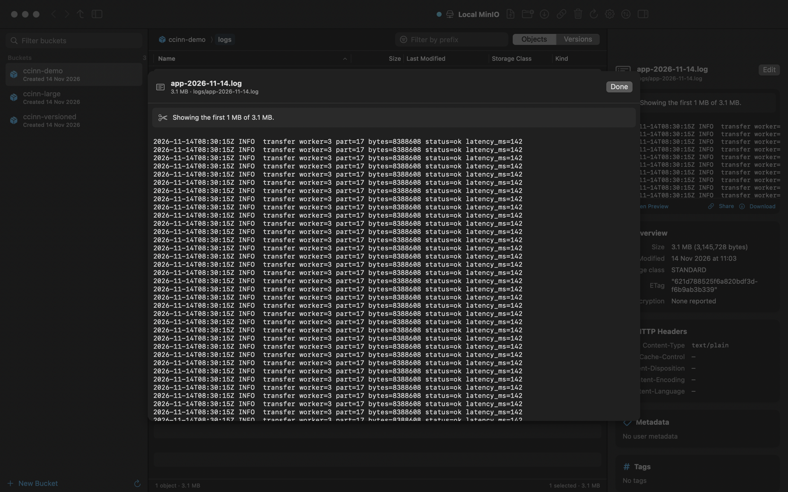 | 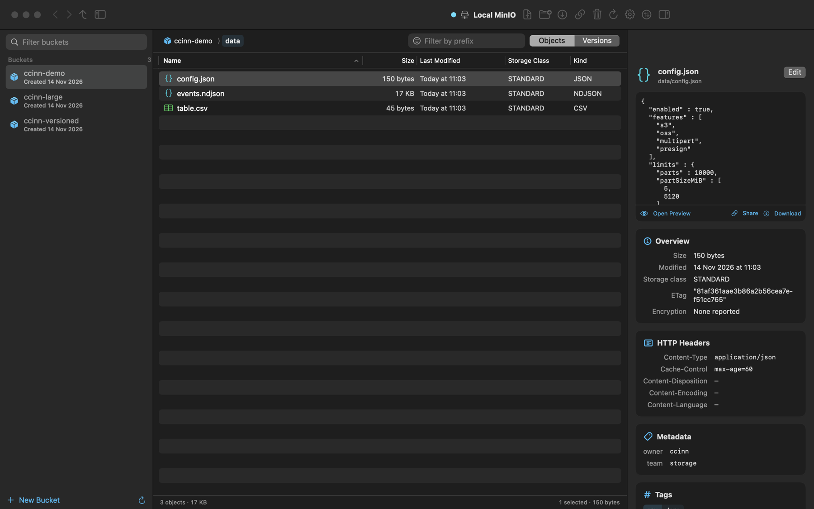 |
| **Editing metadata, storage class and tags** | **Presigned links** |
| 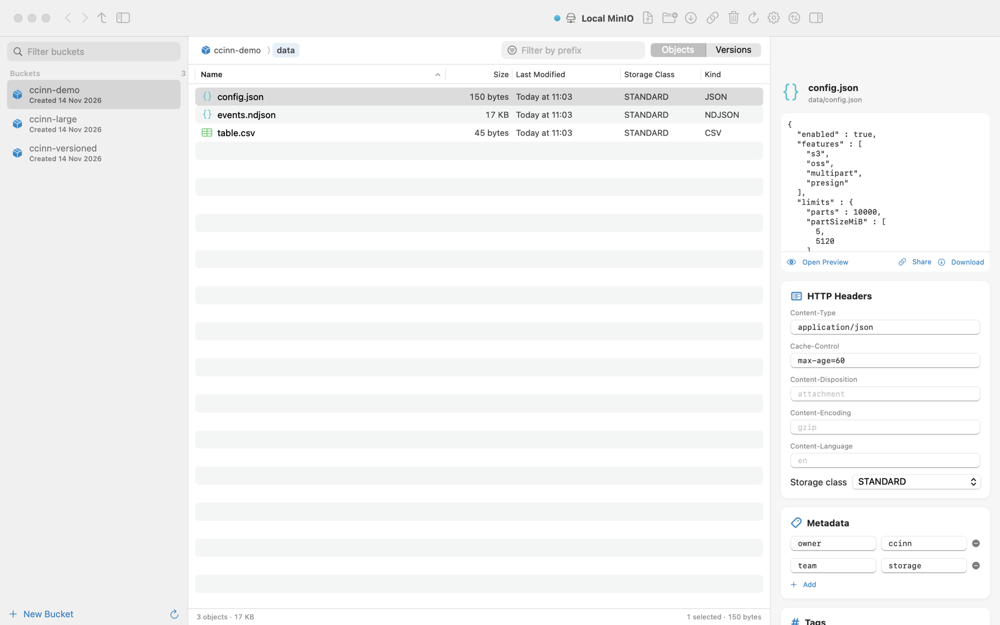 | 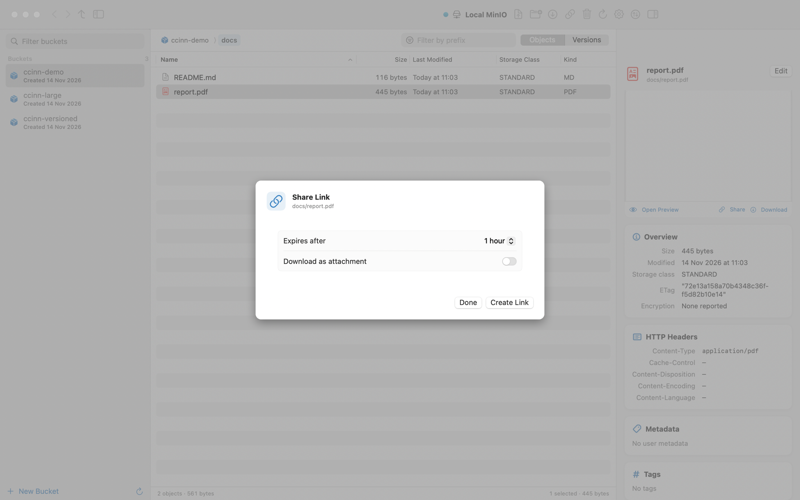 |
| **Incomplete multipart uploads** | **Settings → MCP** |
| 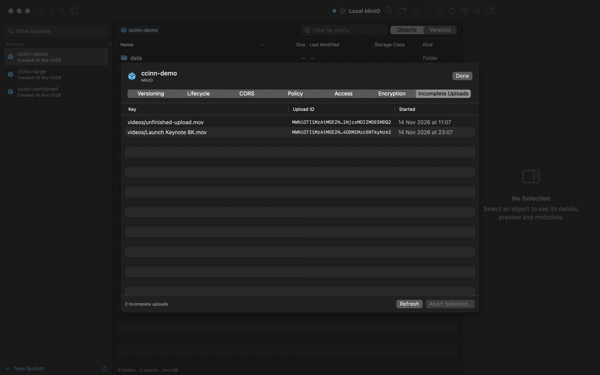 | 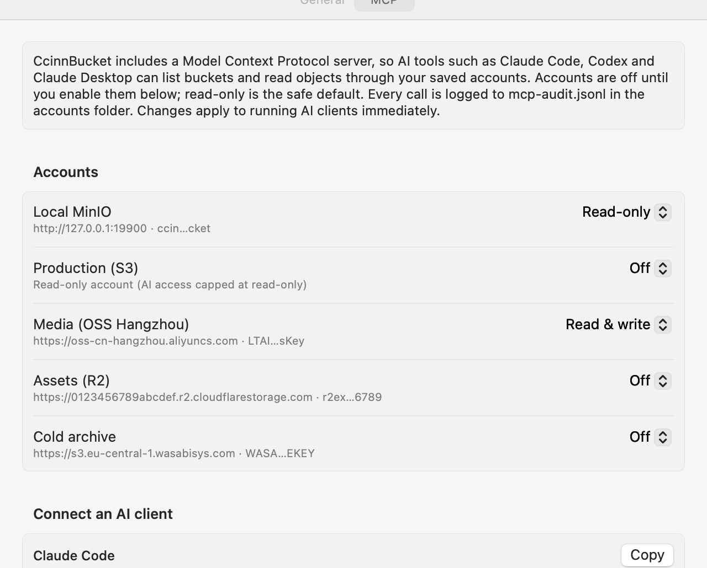 |

## Installation

1. Download `CcinnBucket-<version>.dmg` (or the `.zip`) from the [latest release](https://github.com/whiteCcinn/ccinnbucket/releases/latest).
2. Open the disk image and drag **CcinnBucket** into **Applications**.
3. The app is ad-hoc signed but not notarized. The first time, right-click the app and choose **Open**, or run:

   ```bash
   xattr -dr com.apple.quarantine /Applications/CcinnBucket.app
   ```

Each release lists SHA-256 checksums in `SHA256SUMS.txt`.

## Quick start

1. Click **New Account**, pick a provider (Amazon S3, MinIO, R2, Ceph, Wasabi, Tencent COS, other S3-compatible or Alibaba Cloud OSS), and enter the endpoint (if needed), region and access key. Or click **Import from CLI Config…**.
2. Press **Test** to list your buckets, then **Save & Connect**.
3. Pick a bucket in the sidebar. Double-click folders to open them, press **Space** to preview, drop files on the list to upload.

Useful shortcuts: **⌘[ / ⌘]** back/forward · **⌘↑** enclosing folder · **⌘R** refresh · **⇧⌘N** new folder · **⇧⌘U** upload · **⌥⌘D** download · **⌘⌫** delete · **⌥⌘V** versions · **⌥⌘I** inspector · **⌥⌘T** transfers · **⇧⌘D** disconnect.

## MCP server / AI access

CcinnBucket includes a [Model Context Protocol](https://modelcontextprotocol.io) server, so AI tools can browse and read your object storage through your saved accounts. It is the same app binary started with the `mcp` subcommand; it runs headless over stdio and needs no extra installation.

**1. Enable an account.** Accounts are **off** by default. In the account editor (or **Settings → MCP**) set *AI access via MCP* to **Read-only** or **Read & write**.

**2. Add the server to your client.** The exact commands, with the path of your copy of the app, are in **Settings → MCP** with copy buttons.

```bash
# Claude Code
claude mcp add ccinnbucket -- "/Applications/CcinnBucket.app/Contents/MacOS/CcinnBucket" mcp
```

```toml
# Codex (~/.codex/config.toml)
[mcp_servers.ccinnbucket]
command = "/Applications/CcinnBucket.app/Contents/MacOS/CcinnBucket"
args = ["mcp"]
```

```json
{
  "mcpServers": {
    "ccinnbucket": {
      "command": "/Applications/CcinnBucket.app/Contents/MacOS/CcinnBucket",
      "args": ["mcp"]
    }
  }
}
```

The JSON form works for Claude Desktop (`claude_desktop_config.json`) and most other MCP clients. Add `--read-only` after `mcp` to cap every account at read-only, or `--profile "<account name>"` to choose a default account.

**Tools**

| Tool | Access | What it does |
|---|---|---|
| `list_connections` | read | Accounts enabled for AI access (name, provider, endpoint, region, access level — never secrets) |
| `list_buckets` | read | Buckets with creation date and region |
| `list_objects` | read | One page of objects and folders under a prefix (`delimiter`, `continuation_token`, up to 1,000 entries) |
| `head_object` | read | Size, ETag, dates, content type, storage class, encryption, user metadata |
| `read_object_text` | read | A byte range of a text/JSON object (up to 256 KiB per call); binary objects are refused |
| `object_versions` | read | Versions and delete markers under a prefix |
| `put_text_object` | read & write | Create or replace a UTF-8 text object (up to 1 MiB) |
| `delete_objects` | read & write | Delete up to 100 objects by exact key (no prefixes or wildcards) |
| `copy_object` | read & write | Server-side copy of one object |
| `presign_url` | read & write | Time-limited download link (treated as write-level, because it grants access outside the app) |

**Safety model**

- Consent is per account and **enforced by the app**: disabled accounts are invisible, read-only accounts get a storage client that refuses every write before a request is sent, and an account's own read-only flag (or `--read-only`) caps AI access. Changes in the app apply to running AI clients immediately.
- Hard limits: at most 1,000 entries per listing call, 256 KiB of text per read, 1 MiB per write, 100 keys per delete, a 30-second timeout per call, and results capped at 256 KB (pages shrink rather than skip data).
- Secrets stay in the Keychain and are never sent to the client or logged. Every tool call (time, account, tool, bucket/key arguments, duration, error — never object contents) is appended to `~/Library/Application Support/CcinnBucket/mcp-audit.jsonl`.
- Only protocol messages are written to standard output; the server exits when the client closes the connection.

## Building from source

Requirements: macOS 14+, Xcode 16 or later (Swift 6). No third-party packages.

```bash
git clone https://github.com/whiteCcinn/ccinnbucket.git
cd ccinnbucket
swift build                          # debug build
swift test --skip IntegrationTests   # unit tests
scripts/build-app.sh --open          # build dist/CcinnBucket.app and launch it
scripts/package-release.sh 1.0.0     # universal .app, .zip, .dmg and checksums in dist/
```

### Integration tests against MinIO

Docker is required. The script starts a MinIO container bound to `127.0.0.1:19900` and seeds a demo tree, a bucket with 50,000 objects, unicode and special-character keys, a versioned bucket and an incomplete multipart upload:

```bash
eval "$(scripts/storage-up.sh)"   # exports CCINNBUCKET_IT_* variables
swift build                       # the MCP test drives the built binary
swift test --filter IntegrationTests
scripts/storage-down.sh
```

The suite covers paging through 50,000 keys, V1 listing, special keys, 300 MiB multipart round trips, pause/resume and abort, gzip-encoded objects, versions, settings, clock-skew and region correction, presigned links and a full MCP session against the built binary. Never point it at a real cloud account.

The MCP tests use two variables that are **for tests only**: `CCINNBUCKET_ACCOUNTS_DIR` (read accounts from another folder) and `CCINNBUCKET_TEST_INSECURE_SECRETS` (secrets from a JSON string instead of the Keychain). Never use them with real credentials.

Signature tests use reference vectors produced by the official SDKs (`scripts/vectors/generate_signing_vectors.py`, run in a throw-away virtualenv; the SDKs are not project dependencies).

## Architecture

```
CcinnBucket (SwiftUI + AppKit app; `CcinnBucket mcp` runs the MCP server headless)
 └─ CcinnBucketKit   accounts & Keychain, credential import, navigation, transfer queue, MCP server and tools
     └─ StorageKit   URLSession transport, retries & clock skew, S3/OSS dialects, XML, listing, multipart & download engines
         └─ StorageSigning   AWS SigV4, OSS V4/V1, presigning (pure, no I/O)
```

- **Provider dialects:** one client implements every operation; a dialect supplies what differs (signing, addressing, header prefixes, storage classes, copy limits, ACL format).
- **Bounded everything:** XML parsing rejects DTDs and limits size and depth; in-memory bodies are capped; uploads keep at most a fixed amount of part data in memory; downloads stream to disk with `pwrite`.
- **Resilience:** retries with exponential backoff and full jitter on throttling and 5xx, automatic clock-skew correction, bucket-region discovery with re-signing, and cancellation that reaches the network task.
- **Concurrency safety:** Swift 6 strict concurrency, actors for shared state and small unfair locks only on hot paths.

## Contributing

Contributions are welcome! Please read [CONTRIBUTING.md](CONTRIBUTING.md), and report security issues privately as described in [SECURITY.md](SECURITY.md).

## Contributors

- [whiteCcinn](https://github.com/whiteCcinn)

<a href="https://github.com/whiteCcinn/ccinnbucket/graphs/contributors"></a>

## Star history

[](https://star-history.com/#whiteCcinn/ccinnbucket&Date)

## The ccinn series

Native macOS clients built with the same care:

| App | What it is |
|---|---|
| [CcinnMongo](https://github.com/whiteCcinn/ccinnmongo) | Native MongoDB client for every server from 2.6 to 8.x (legacy OP_QUERY and modern OP_MSG). |
| [CcinnStarRocks](https://github.com/whiteCcinn/ccinnstarrocks) | Native StarRocks client: partitions, tablets & skew, async/sync materialized views, running tasks, SQL with completion and charts. |
| [CcinnRedis](https://github.com/whiteCcinn/ccinnredis) | Native Redis client for Redis 2.8 → 8.x and Valkey; standalone, Sentinel, Cluster and proxies. |
| **CcinnBucket** (this project) | Object storage browser for Amazon S3 / S3-compatible services and Alibaba Cloud OSS. |

## License

[MIT](LICENSE) © 2026 whiteCcinn. Amazon S3 is a trademark of Amazon.com, Inc. or its affiliates; Alibaba Cloud and OSS are trademarks of Alibaba Group. MinIO, Cloudflare R2, Ceph, Wasabi and Tencent Cloud are trademarks of their respective owners. This project is not affiliated with or endorsed by any of them.
