<p align="center">
  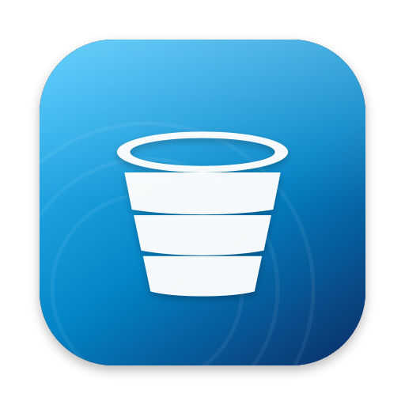
</p>

<h1 align="center">CcinnBucket</h1>

<p align="center">
  <b>快速、原生的 macOS 对象存储客户端：支持 Amazon S3、S3 兼容服务与阿里云 OSS。</b><br>
  流畅浏览上百万对象的存储桶，用可续传的分片传输搬运数 GB 的文件，并通过 MCP 让 AI 工具安全地探索你的存储。
</p>

<p align="center">
  <a href="https://github.com/whiteCcinn/ccinnbucket/actions/workflows/ci.yml"></a>
  <a href="https://github.com/whiteCcinn/ccinnbucket/releases/latest"></a>
  
  
  
  
  <a href="LICENSE"></a>
</p>

<p align="center">
  <a href="README.md">English</a> · 简体中文
</p>

<p align="center">
  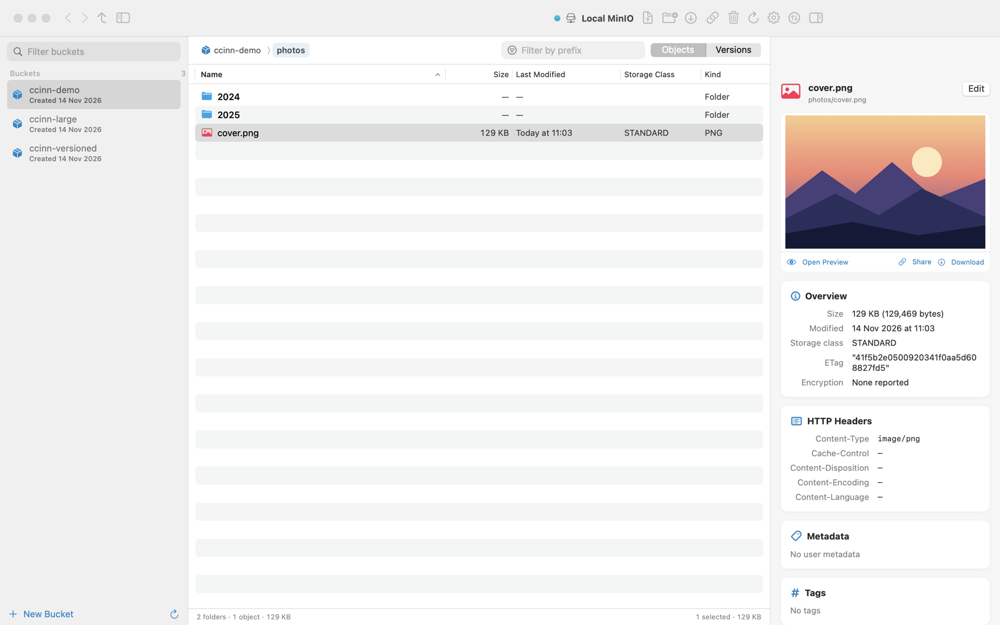
</p>

## 为什么选择 CcinnBucket？

对象存储工具往往是网页控制台、命令行工具，或者把阿里云 OSS 当作“附带支持”的跨平台应用。CcinnBucket 是一款原生 SwiftUI/AppKit 应用，拥有**自研的签名与存储协议栈**——AWS Signature V4、OSS Signature V4（`OSS4-HMAC-SHA256`）以及旧版 OSS V1 签名——全部从零实现，并与官方 SDK 逐字节比对验证。同一套界面即可操作 Amazon S3、MinIO、Cloudflare R2、Ceph RGW、Wasabi、腾讯云 COS（S3 API）和阿里云 OSS。没有 Electron，没有捆绑运行时，没有遥测，也没有任何第三方依赖。

## 功能

- **覆盖常见服务商**——Amazon S3（虚拟主机式或路径式寻址、自动发现存储桶所在区域、STS 临时凭证）、自定义 Endpoint 的 S3 兼容服务，以及阿里云 OSS 原生 API（公网、内网与传输加速 Endpoint、自定义域名、OSS V4 或 V1 签名）。
- **超大存储桶依然流畅**——基于前缀的文件夹导航（面包屑、前进/后退）、使用 continuation token 的 ListObjectsV2 分页（旧服务器自动回退到 V1）、虚拟化表格流畅滚动 5 万+ 对象、服务端前缀过滤、排序与多选。
- **检查器与预览**——大小、ETag、时间、存储类型、Content-Type、缓存头、用户元数据、标签、版本与加密信息。文本（通过 Range 请求读取前 1 MiB）、格式化 JSON、图片、PDF，以及 QuickLook 能识别的一切格式。
- **就地编辑**——修改 Content-Type、缓存头、用户元数据、存储类型与标签；头部修改通过服务端自我复制完成（大对象使用分片复制），未修改的内容全部保留。
- **为数 GB 文件而生的传输**——拖放上传文件与文件夹；内存受控的并行分片上传，可配置分片大小；暂停 / 继续 / 取消（取消会中止分片上传）；可续传的并行 Range 下载，先写入临时文件、完成后才重命名；传输队列显示每个任务和总体吞吐量。
- **日常操作**——新建文件夹、重命名、复制与移动（服务端完成；S3 超过 5 GiB、OSS 超过 1 GiB 时使用分片复制）、批量删除（确认框会显示对象数量）、带有效期选择的预签名链接、版本与删除标记（可恢复历史版本），以及可查看与中止的未完成分片上传。
- **存储桶设置**——版本控制（启用/暂停）、生命周期、CORS、桶策略、ACL 与默认加密，以易读摘要和原始文档两种形式展示。
- **多窗口**——每个窗口都有独立的连接，可以并排浏览不同的账户，也可以为同一个账户再开一个窗口。**文件 ▸ 新建 CcinnBucket 窗口（New CcinnBucket Window）**（⌘N）打开账户界面；**在新窗口中使用此连接（New Window with This Connection）**（⌥⌘N，工具栏上的 **新建窗口** 按钮也可以）会用相同的凭证在另一个窗口中连接当前账户，即使该账户没有保存；在已保存账户的右键菜单中选择 **在新窗口中打开（Open in New Window）**，即可在新窗口中连接该账户。关闭某个窗口只会断开这个窗口的连接。
- **安全设计**——Secret Key 与 Session Token 只保存在 macOS 钥匙串；每个账户可开启**只读模式**，在界面之下拒绝一切修改；破坏性操作必先确认；可以只读方式导入 `~/.aws`、`~/.alibabacloud`、`~/.ossutilconfig` 与 `~/.aliyun/config.json` 中的凭证。
- **通过 MCP 提供 AI 访问**（需手动开启）——内置 Model Context Protocol 服务，Claude Code、Codex、Claude Desktop 等 MCP 客户端可以通过你授权的账户列出存储桶、读取对象。参见 [MCP 服务](#mcp-服务--ai-访问)。

## 支持的服务

| 服务 | API | 签名 | 测试情况 |
|---|---|---|---|
| Amazon S3 | S3 REST | AWS SigV4（请求头与预签名） | ✅ AWS 官方文档的 SigV4 示例与 botocore 生成的测试向量 |
| MinIO | S3 REST | AWS SigV4 | ✅ 真实环境集成测试（MinIO RELEASE.2025-07-23） |
| Cloudflare R2、Ceph RGW、Wasabi、腾讯云 COS（S3 API）及其他 S3 兼容服务 | S3 REST | AWS SigV4 | 提供预设；与 MinIO 走同一代码路径 |
| 阿里云 OSS | OSS REST | `OSS4-HMAC-SHA256`（V4）、HMAC-SHA1（V1） | ✅ 来自 `alibabacloud-oss-v2`（并与 `oss2` 交叉验证）及 `oss2` 的测试向量；请求构造测试。CI 中未连接真实 OSS 服务。 |

CcinnBucket 需要 **macOS 14 Sonoma 或更高版本**（Apple 芯片与 Intel 均可）。

## 截图

| 完整加载 50,000 个对象 | 传输队列中的分片上传 |
|---|---|
| 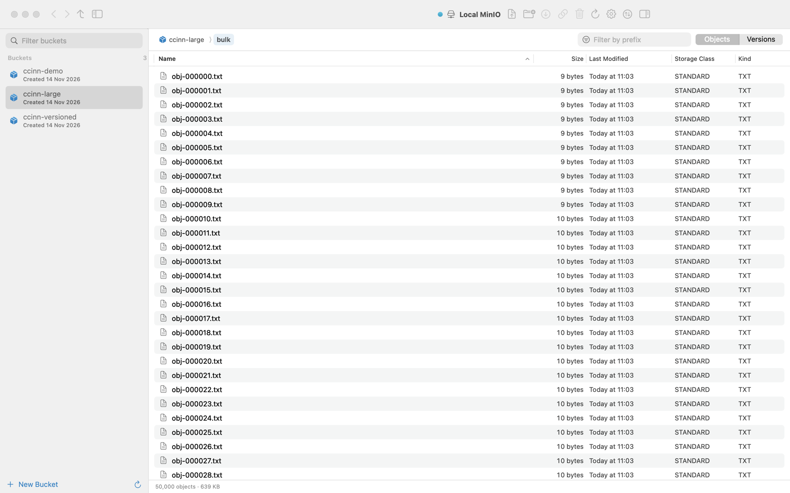 | 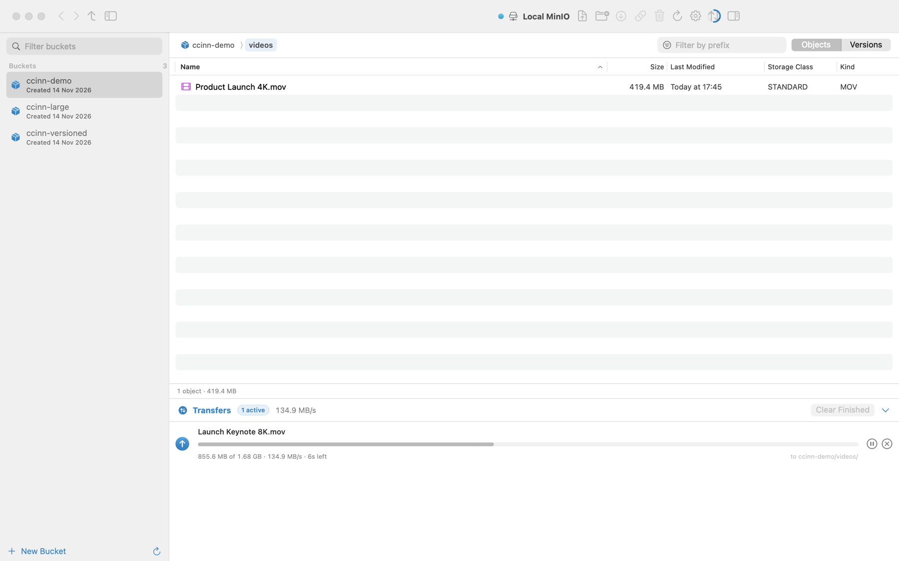 |
| **账户与服务商** | **版本与删除标记** |
| 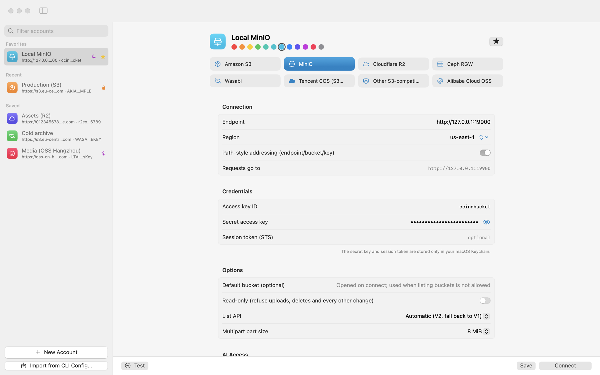 | 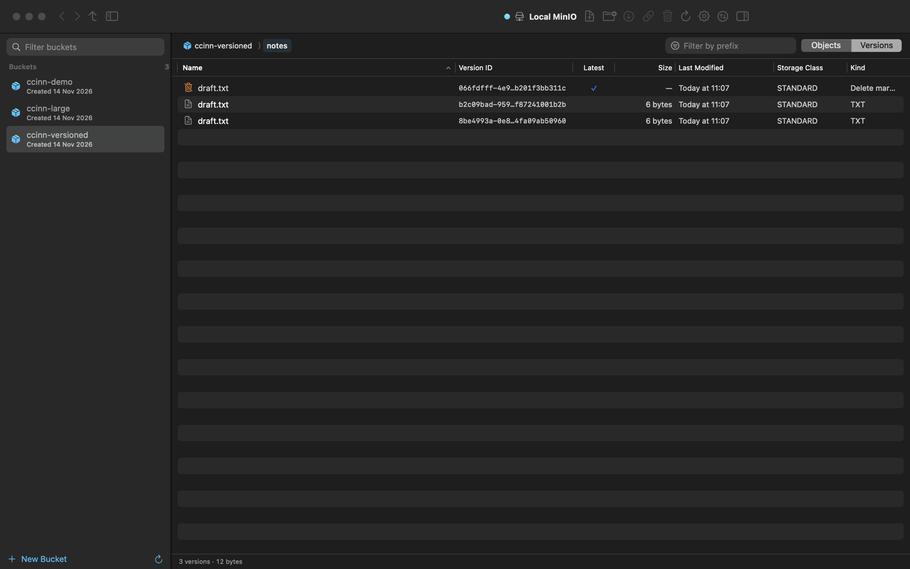 |
| **Range 文本预览（3 MB 日志的前 1 MiB）** | **深色模式下的检查器** |
| 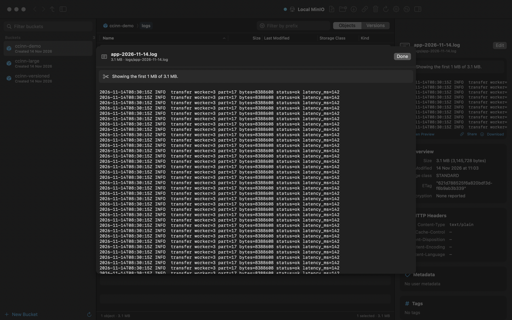 | 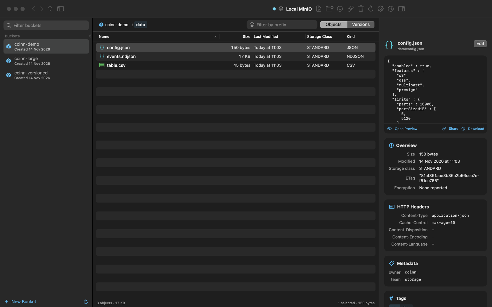 |
| **编辑元数据、存储类型与标签** | **预签名链接** |
| 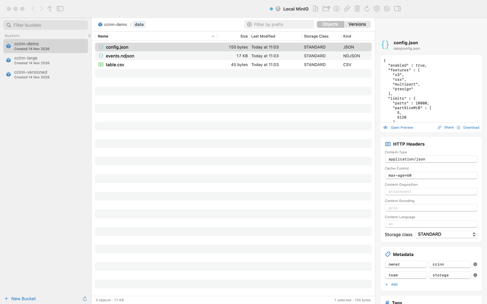 | 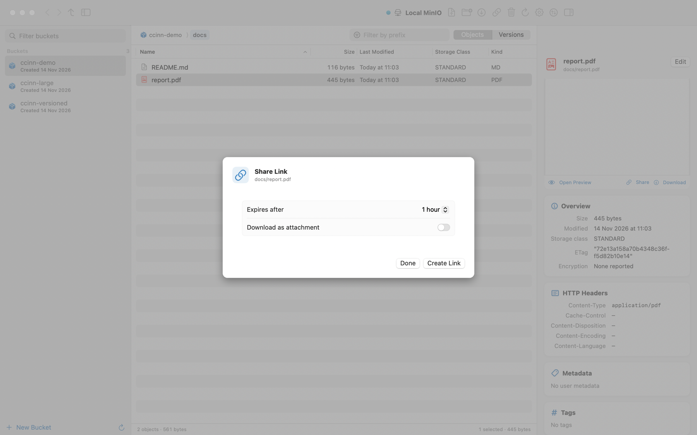 |
| **未完成的分片上传** | **设置 → MCP** |
| 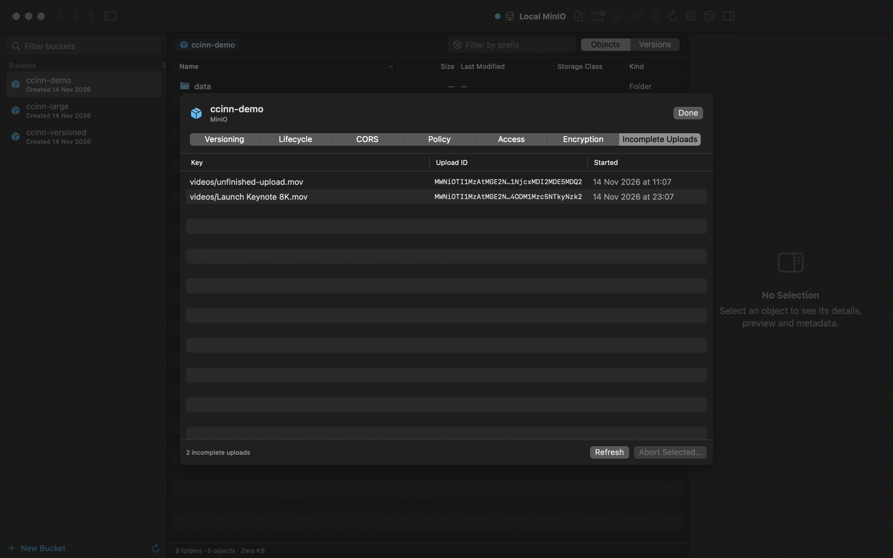 | 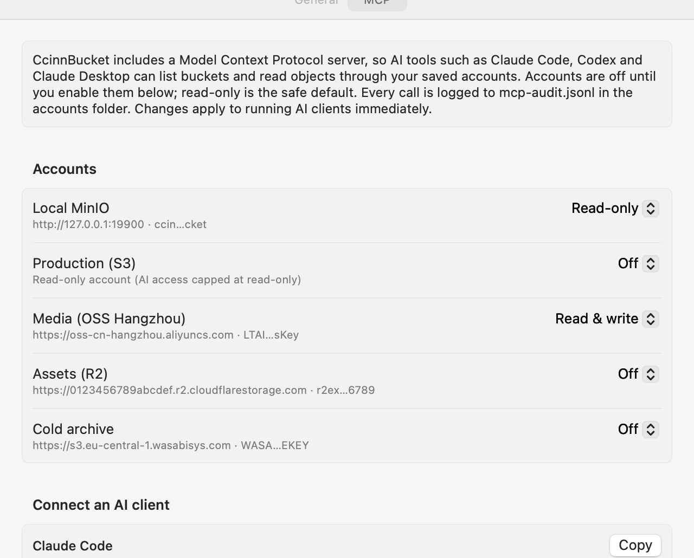 |

## 安装

1. 从[最新版本](https://github.com/whiteCcinn/ccinnbucket/releases/latest)下载 `CcinnBucket-<version>.dmg`（或 `.zip`）。
2. 打开磁盘映像，把 **CcinnBucket** 拖入 **应用程序**。
3. 应用使用 ad-hoc 签名，未经公证。首次打开时请右键点击应用并选择 **打开**，或运行：

   ```bash
   xattr -dr com.apple.quarantine /Applications/CcinnBucket.app
   ```

每个版本都附带 `SHA256SUMS.txt` 校验和。

### 更新

选择 **CcinnBucket → 检查更新…（Check for Updates…）**。如果有新版本，CcinnBucket 会显示更新内容。**下载并打开（Download & Open）** 会把磁盘映像保存到“下载”文件夹，按该版本的 `SHA256SUMS.txt` 校验后再打开。退出 CcinnBucket，然后把新版本拖到 **应用程序** 文件夹即可。

CcinnBucket 每天也会在后台自动检查一次，可以在 **设置 → 通用 → 更新** 中关闭。检查只访问 GitHub 的公开 Releases API，也可以选择 **跳过此版本（Skip This Version）**。

项目主页、发布说明和问题反馈入口也在 **帮助** 菜单和“关于”窗口中。

## 快速上手

1. 点击 **New Account**，选择服务商（Amazon S3、MinIO、R2、Ceph、Wasabi、腾讯云 COS、其他 S3 兼容服务或阿里云 OSS），填写 Endpoint（如需要）、区域与 Access Key；也可以点击 **Import from CLI Config…** 导入。
2. 点击 **Test** 列出存储桶，然后点击 **Save & Connect**。
3. 在侧边栏选择存储桶。双击文件夹进入，按 **空格** 预览，把文件拖到列表即可上传。

常用快捷键：**⌘[ / ⌘]** 后退/前进 · **⌘↑** 上级文件夹 · **⌘R** 刷新 · **⇧⌘N** 新建文件夹 · **⇧⌘U** 上传 · **⌥⌘D** 下载 · **⌘⌫** 删除 · **⌥⌘V** 版本 · **⌥⌘I** 检查器 · **⌥⌘T** 传输 · **⇧⌘D** 断开连接 · **⌘N** 新建窗口 · **⌥⌘N** 在新窗口中使用此连接。

## MCP 服务 / AI 访问

CcinnBucket 内置 [Model Context Protocol](https://modelcontextprotocol.io) 服务，AI 工具可以通过你保存的账户浏览和读取对象存储。它就是同一个应用程序，以 `mcp` 子命令启动，通过 stdio 无界面运行，无需额外安装。

**1. 为账户开启访问。** 所有账户默认**关闭**。在账户编辑器（或 **设置 → MCP**）中把 *AI access via MCP* 设为 **Read-only（只读）** 或 **Read & write（读写）**。

**2. 把服务添加到客户端。** **设置 → MCP** 中提供了包含你本机应用路径的完整命令，并带有复制按钮。

```bash
# Claude Code
claude mcp add ccinnbucket -- "/Applications/CcinnBucket.app/Contents/MacOS/CcinnBucket" mcp
```

```toml
# Codex（~/.codex/config.toml）
[mcp_servers.ccinnbucket]
command = "/Applications/CcinnBucket.app/Contents/MacOS/CcinnBucket"
args = ["mcp"]
```

```json
{
  "mcpServers": {
    "ccinnbucket": {
      "command": "/Applications/CcinnBucket.app/Contents/MacOS/CcinnBucket",
      "args": ["mcp"]
    }
  }
}
```

JSON 形式适用于 Claude Desktop（`claude_desktop_config.json`）以及大多数其他 MCP 客户端。在 `mcp` 后加上 `--read-only` 可把所有账户限制为只读，加上 `--profile "<账户名>"` 可指定默认账户。

**工具**

| 工具 | 权限 | 作用 |
|---|---|---|
| `list_connections` | 读 | 已开启 AI 访问的账户（名称、服务商、Endpoint、区域、权限级别——绝不包含密钥） |
| `list_buckets` | 读 | 存储桶及其创建时间、区域 |
| `list_objects` | 读 | 某个前缀下的一页对象与文件夹（`delimiter`、`continuation_token`，每次最多 1,000 条） |
| `head_object` | 读 | 大小、ETag、时间、Content-Type、存储类型、加密、用户元数据 |
| `read_object_text` | 读 | 读取文本/JSON 对象的一段字节（每次最多 256 KiB）；拒绝二进制对象 |
| `object_versions` | 读 | 前缀下的版本与删除标记 |
| `put_text_object` | 读写 | 创建或覆盖 UTF-8 文本对象（最多 1 MiB） |
| `delete_objects` | 读写 | 按精确 Key 删除最多 100 个对象（不支持前缀或通配符） |
| `copy_object` | 读写 | 服务端复制单个对象 |
| `presign_url` | 读写 | 生成有时效的下载链接（因其在应用之外授予访问权，按写权限对待） |

**安全模型**

- 授权按账户进行，并**由应用强制执行**：未开启的账户对 AI 不可见；只读账户使用的存储客户端会在发出请求之前拒绝一切写操作；账户自身的只读开关（或 `--read-only`）会把 AI 访问限制为只读。在应用中所做的修改会立即对正在运行的 AI 客户端生效。
- 硬性限制：每次列举最多 1,000 条，每次读取最多 256 KiB 文本，每次写入最多 1 MiB，每次删除最多 100 个 Key，每次调用 30 秒超时，结果最大 256 KB（超限时缩小分页而不是丢弃数据）。
- 密钥只保存在钥匙串中，绝不会发送给客户端或写入日志。每次工具调用（时间、账户、工具、桶/Key 参数、耗时、错误——绝不记录对象内容）都会追加到 `~/Library/Application Support/CcinnBucket/mcp-audit.jsonl`。
- 标准输出只写入协议消息；客户端关闭连接后服务会自动退出。

## 从源码构建

要求：macOS 14+、Xcode 16 或更高版本（Swift 6）。没有第三方依赖。

```bash
git clone https://github.com/whiteCcinn/ccinnbucket.git
cd ccinnbucket
swift build                          # 调试构建
swift test --skip IntegrationTests   # 单元测试
scripts/build-app.sh --open          # 构建 dist/CcinnBucket.app 并启动
scripts/package-release.sh 1.0.0     # 通用架构 .app、.zip、.dmg 及校验和，输出到 dist/
```

### 基于 MinIO 的集成测试

需要 Docker。脚本会启动一个绑定在 `127.0.0.1:19900` 的 MinIO 容器，并写入演示目录、包含 50,000 个对象的存储桶、Unicode 与特殊字符 Key、启用版本控制的存储桶以及一个未完成的分片上传：

```bash
eval "$(scripts/storage-up.sh)"   # 导出 CCINNBUCKET_IT_* 环境变量
swift build                       # MCP 测试会驱动构建出的程序
swift test --filter IntegrationTests
scripts/storage-down.sh
```

测试覆盖：分页遍历 50,000 个 Key、V1 列举、特殊 Key、300 MiB 分片上传与下载往返、暂停/继续与中止、gzip 编码对象、版本、存储桶设置、时钟偏差与区域纠正、预签名链接，以及针对构建产物的完整 MCP 会话。请勿把它指向真实的云账户。

MCP 测试会用到两个**仅限测试**的环境变量：`CCINNBUCKET_ACCOUNTS_DIR`（从其他目录读取账户）和 `CCINNBUCKET_TEST_INSECURE_SECRETS`（从 JSON 字符串而不是钥匙串读取密钥）。切勿在真实凭证上使用。

签名测试使用官方 SDK 生成的参考向量（`scripts/vectors/generate_signing_vectors.py`，在临时 virtualenv 中运行；这些 SDK 不是项目依赖）。

## 架构

```
CcinnBucket（SwiftUI + AppKit 应用；`CcinnBucket mcp` 以无界面方式运行 MCP 服务）
 └─ CcinnBucketKit   账户与钥匙串、凭证导入、导航、传输队列、MCP 服务与工具
     └─ StorageKit   URLSession 传输、重试与时钟偏差、S3/OSS 方言、XML、列举、分片与下载引擎
         └─ StorageSigning   AWS SigV4、OSS V4/V1、预签名（纯函数，无 I/O）
```

- **服务商方言**：一个客户端实现所有操作，由“方言”提供差异部分（签名、寻址、头部前缀、存储类型、复制上限、ACL 格式）。
- **处处有界**：XML 解析拒绝 DTD 并限制大小与深度；内存中的响应体有上限；上传时内存中的分片数据量固定受限；下载通过 `pwrite` 直接流式写入磁盘。
- **健壮性**：对限流和 5xx 使用指数退避加完全抖动重试，自动纠正时钟偏差，发现存储桶区域后重新签名，取消操作可直达网络任务。
- **并发安全**：Swift 6 严格并发检查，共享状态使用 actor，仅在热点路径使用轻量的 unfair lock。

## 参与贡献

欢迎贡献！请先阅读 [CONTRIBUTING.md](CONTRIBUTING.md)，安全问题请按 [SECURITY.md](SECURITY.md) 中的说明私下报告。

## 贡献者

- [whiteCcinn](https://github.com/whiteCcinn)

<a href="https://github.com/whiteCcinn/ccinnbucket/graphs/contributors"></a>

## Star 历史

[](https://star-history.com/#whiteCcinn/ccinnbucket&Date)

## ccinn 系列

同样用心打造的原生 macOS 客户端：

| 应用 | 简介 |
|---|---|
| [CcinnMongo](https://github.com/whiteCcinn/ccinnmongo) | 原生 MongoDB 客户端，支持 2.6 到 8.x 的所有服务器（兼容旧版 OP_QUERY 与现代 OP_MSG）。 |
| [CcinnStarRocks](https://github.com/whiteCcinn/ccinnstarrocks) | 原生 StarRocks 客户端：分区、Tablet 与数据倾斜、异步/同步物化视图、运行中的任务，以及带补全和图表的 SQL。 |
| [CcinnRedis](https://github.com/whiteCcinn/ccinnredis) | 原生 Redis 客户端，支持 Redis 2.8 → 8.x 与 Valkey；单机、Sentinel、Cluster 以及代理。 |
| **CcinnBucket**（本项目） | 面向 Amazon S3 / S3 兼容服务与阿里云 OSS 的对象存储浏览器。 |
| [CcinnMysql](https://github.com/whiteCcinn/ccinnmysql) | 原生 MySQL、MariaDB 与 Percona 客户端，支持 5.5 → 9.x：TLS 与全部认证插件、InnoDB 锁、Top 语句、复制、可视化 EXPLAIN 与安全的行内编辑。 |
| [CcinnPsql](https://github.com/whiteCcinn/ccinnpsql) | 原生 PostgreSQL 客户端，支持 9.6 → 18：阻塞树、索引与膨胀分析、复制与复制槽、可视化 EXPLAIN ANALYZE，并识别 PgBouncer 与 Pgpool。 |
| [CcinnClickHouse](https://github.com/whiteCcinn/ccinnclickhouse) | 原生 ClickHouse 客户端，支持 22.8 → 26.x：引擎族、Part 与压缩、Merge、Mutation、复制、查询日志分析与集群拓扑。 |

## 许可证

[MIT](LICENSE) © 2026 whiteCcinn。Amazon S3 是 Amazon.com, Inc. 或其关联公司的商标；阿里云与 OSS 是阿里巴巴集团的商标；MinIO、Cloudflare R2、Ceph、Wasabi 与腾讯云是其各自所有者的商标。本项目与上述公司均无关联，也未获得其认可。
